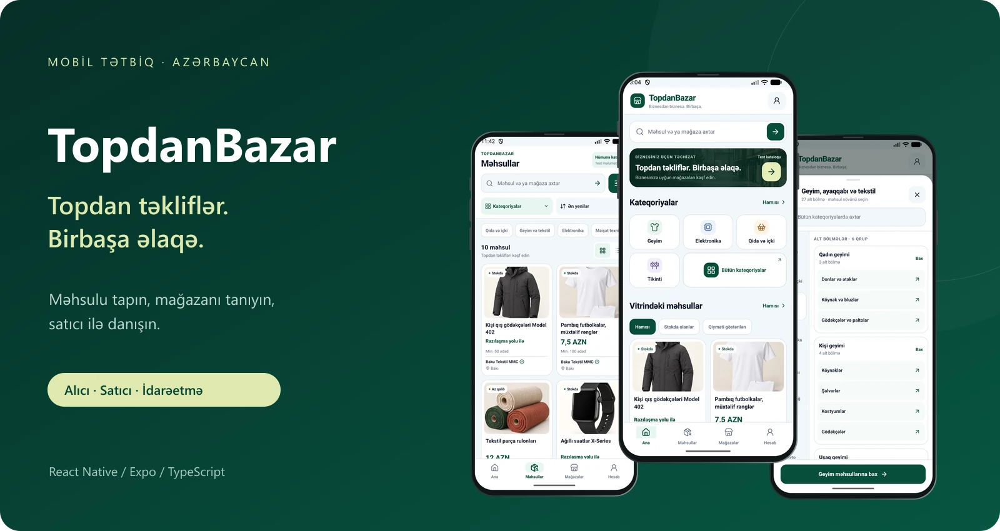
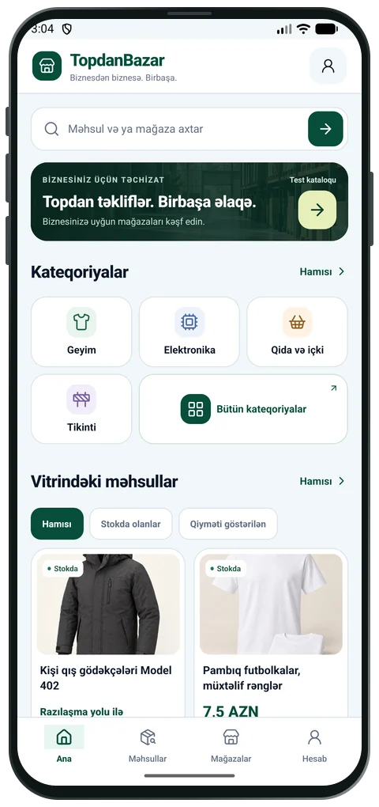
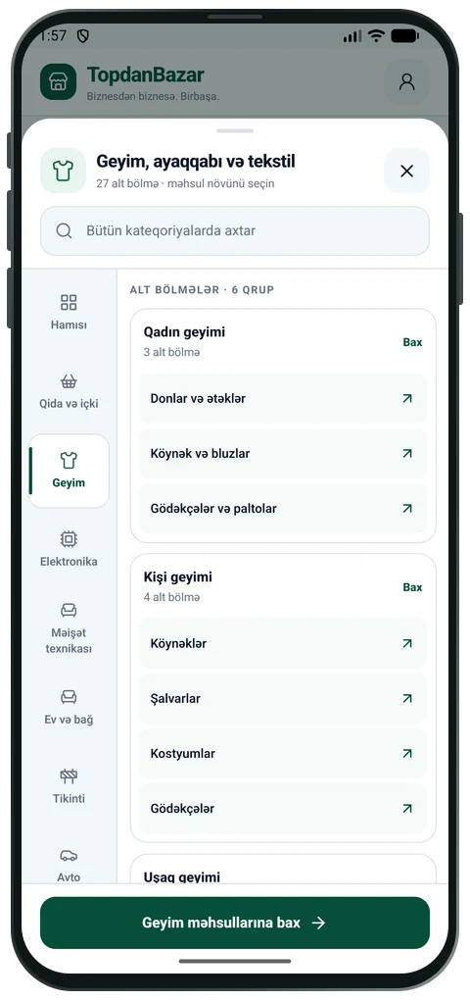
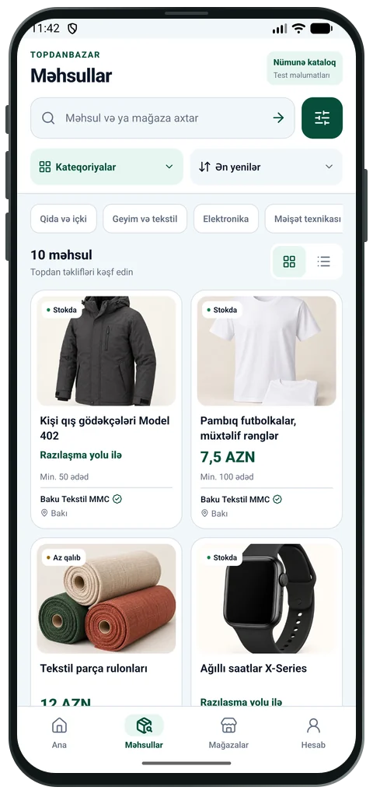
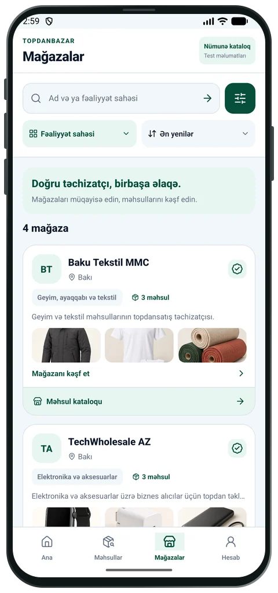
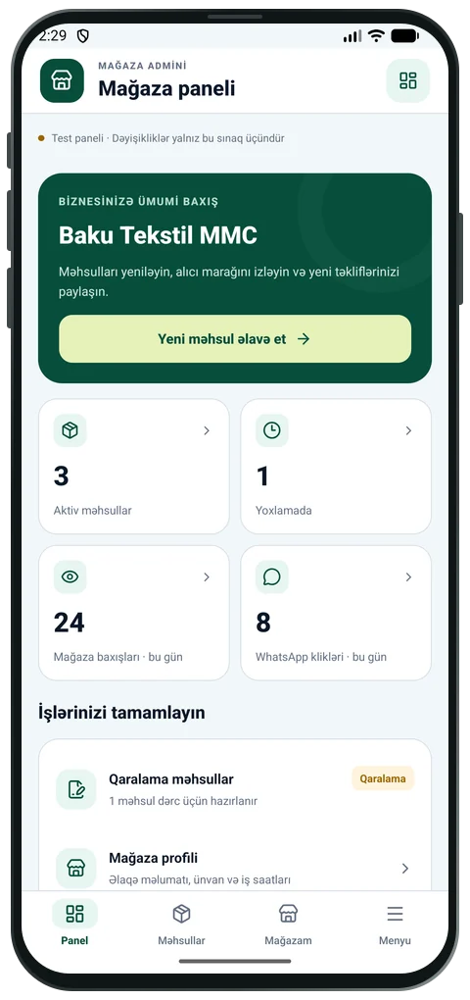
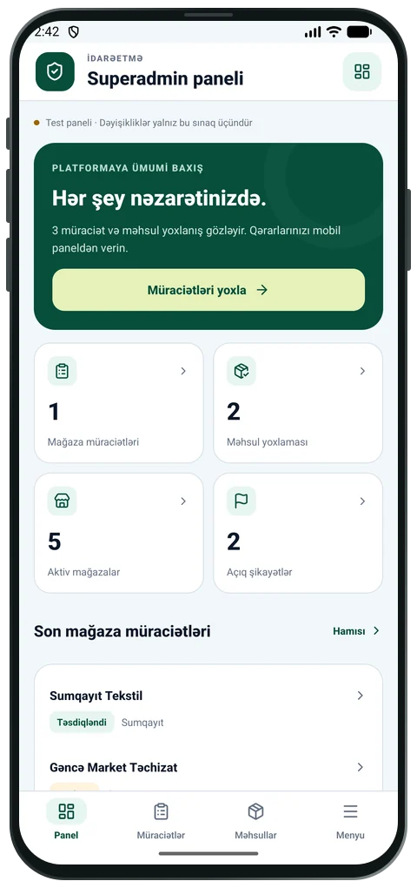

<p align="center">
  
</p>

# TopdanBazar

Azərbaycanın topdansatış bazarı üçün mobil tətbiq. Alıcı məhsulları və mağazaları araşdırır, qiymət və minimum sifariş şərtlərinə baxır, satıcı ilə WhatsApp və ya telefon vasitəsilə əlaqə saxlayır.

Tətbiqi üç tərəf üçün hazırlayırıq: alıcılar, mağaza sahibləri və platformanı idarə edən komanda. Hazırda inkişaf və sınaq mərhələsindədir.

**iOS və Android · Azərbaycan dilində · İşıqlı görünüş**

[Ekranlar](#ekranlar) · [İmkanlar](#i%CC%87mkanlar) · [Quraşdırma](#quraşdırma) · [Sənədlər](#sənədlər)

## Ekranlar

<table>
  <tr>
    <th>Ana səhifə</th>
    <th>Kateqoriyalar</th>
    <th>Məhsullar</th>
  </tr>
  <tr>
    <td align="center"><a href="docs/images/home.webp"></a></td>
    <td align="center"><a href="docs/images/categories.webp"></a></td>
    <td align="center"><a href="docs/images/products.webp"></a></td>
  </tr>
  <tr>
    <th>Mağazalar</th>
    <th>Mağaza admini</th>
    <th>Superadmin</th>
  </tr>
  <tr>
    <td align="center"><a href="docs/images/stores.webp"></a></td>
    <td align="center"><a href="docs/images/seller.webp"></a></td>
    <td align="center"><a href="docs/images/admin.webp"></a></td>
  </tr>
</table>

*Şəkillər nümunə kataloq və sınaq panellərindən götürülüb. Android ekran çəkilişləri iPhone üslubunda çərçivədə təqdim olunur. Böyütmək üçün şəklin üzərinə klikləyin.*

## İmkanlar

### Alıcı üçün

- Məhsul və mağaza axtarışı, kateqoriya ağacı və alt kateqoriyalar.
- Şəhər, qiymət, stok və təsdiqlənmiş mağazaya görə filtrlər; sıralama və siyahı/kart görünüşü.
- Məhsul şəkilləri, topdan qiymət, minimum sifariş və mağaza profili.
- Seçilmiş məhsullar və mağazalar, son baxılanlar və son axtarışlar.
- “Axtardığım məhsul” bölməsində tələb yerləşdirmək və satıcı təkliflərinə baxmaq.
- Məhsul və mağaza paylaşımı, problem bildirmə, mağaza açma və dəstək müraciətləri.

### Mağaza sahibi üçün

Məhsul əlavə etmək və redaktə etmək, qaralamanı saxlamaq, yoxlanışa göndərmək, mağaza profilini yeniləmək və alıcı tələblərinə təklif vermək. Paneldə baxışlar, əlaqə klikləri və məhsul statusları göstərilir.

### İdarəetmə üçün

Mağaza müraciətləri və məhsul yoxlamaları, təsdiq/rədd əməliyyatları, istifadəçilər, kateqoriyalar, şikayətlər, statistika və audit qeydləri.

### Gündəlik istifadədə

Formalar avtomatik qaralama saxlayır; yazılanları itirmədən geri qayıtmaq mümkündür. Bağlantı kəsiləndə əvvəl yüklənmiş açıq kataloq məlumatları göstərilə bilər və köhnə məlumat ayrıca işarələnir. Canlı API-yə qoşulanda seçilmişlər və hesaba bağlı alıcı tələbləri cihazlar arasında sinxronlaşır.

TopdanBazar-da səbət, onlayn ödəniş və çatdırılma axını yoxdur. Satış şərtləri alıcı ilə satıcı arasında dəqiqləşdirilir.

## Quraşdırma

Node.js-in Expo SDK 57 ilə uyğun versiyası, npm və telefonda uyğun Expo Go lazımdır. Native Android yığımı üçün Android SDK, iOS yığımı üçün macOS və Xcode tələb olunur.

```sh
git clone https://github.com/IsrafilIsakhli/topdanci-mobile.git
cd topdanci-mobile
npm ci
```

`.env.example` faylının surətini `.env` adı ilə yaradın.

Windows / PowerShell:

```powershell
Copy-Item .env.example .env
```

macOS / Linux:

```sh
cp .env.example .env
```

### Telefonda açmaq

Nümunə kataloq üçün ayrıca server və məlumat bazası lazım deyil. `EXPO_PUBLIC_DEMO_CATALOG=true` saxlayın:

```sh
npm run phone
```

Telefon və kompüter eyni Wi-Fi-da olmalıdır. iPhone-da Kamera ilə terminaldakı QR-kodu oxudun və Expo Go ilə açın. Android-də Expo Go-nun QR oxuyucusundan istifadə edin.

Wi-Fi bağlantısı alınmırsa:

```sh
npm run phone:tunnel
```

Expo hesabına giriş tələb olunarsa, kompüterdə `npx expo login --browser` işlədin və Expo Go-da eyni hesabı seçin. Tunel üçün əlavə paket quraşdırılması istənə bilər.

Metro prosesi işləməlidir. Lokal kompüter söndürülsə, həmin test bağlantısı dayanır. Codespaces istifadə edirsinizsə, Codespace və oradakı Metro prosesi aktiv qalmalıdır. Bu rejim App Store və ya Play Store buraxılışı deyil.

### Panelləri sınamaq

Nümunə rejimində giriş səhifəsində mağaza admini və superadmin üçün test kartları var. Bunlar yalnız inkişaf rejimində işləyir və real hesablara səlahiyyət vermir.

[Test girişləri və panel imkanları →](docs/ADMIN_PANELS.md)

### Canlı API-yə qoşulmaq

```dotenv
EXPO_PUBLIC_DEMO_CATALOG=false
EXPO_PUBLIC_API_BASE_URL=https://api.example.com/api/v1
EXPO_PUBLIC_WEB_BASE_URL=https://example.com
EXPO_PUBLIC_CDN_BASE_URL=
```

Yuxarıdakı ünvanları öz xidmətlərinizlə əvəz edin. API-də mobil giriş, alıcı tələbləri və seçilmişlər üçün uyğun endpoint-lər və miqrasiyalar olmalıdır.

Backend ayrıca [Topdanci.az reposunda](https://github.com/IsrafilIsakhli/Topdanci.az) saxlanılır. Bu repo mobil tətbiqin kodudur.

`.env` dəyişəndə Metro-nu yenidən başladın. Fiziki telefonda `localhost` kompüterə yönəlmir; lokal API üçün kompüterin LAN ünvanını və ya telefonun çata bildiyi HTTPS ünvanını yazın. `EXPO_PUBLIC_*` dəyişənləri mobil paketdə görünür — məxfi açarları burada saxlamayın.

## Hazırkı vəziyyət

| Bölmə | Vəziyyət |
| --- | --- |
| Kataloq, axtarış, kateqoriyalar və idarəetmə panelləri | Nümunə rejimində sınaqdan keçirilə bilər |
| Canlı giriş, müraciətlər və hesab sinxronlaşması | Yenilənmiş API və miqrasiyalar tələb edir |
| İnternet olmayanda kataloqa baxış | Əvvəl yüklənmiş açıq məlumatlarla işləyir; bütün məlumat və şəkillər üçün zəmanət vermir |
| Şifrə bərpası | Kod hazırdır; e-poçt xidməti və göndərən domen qoşulmalıdır |
| Push bildirişləri | Kod hazırdır; Expo/EAS, FCM/APNs və uyğun native build qurulmalıdır |
| Sayt linkindən tətbiqin birbaşa açılması | Domen əlaqələndirməsi və yeni native build tələb edir |

Nümunə rejimində əlaqə düymələri real zəng və mesaj açmır, müraciət və şikayətlər serverə göndərilmir. Release yığımında nümunə kataloq və test girişləri aktiv deyil.

[Canlı rejim, şifrə bərpası və bildirişlərin quraşdırılması →](docs/BUYER_FEATURES.md)

## Texniki quruluş

| Hissə | İstifadə olunan |
| --- | --- |
| Tətbiq | React Native 0.86 · Expo SDK 57 · React 19 · TypeScript |
| Səhifələr və keçidlər | Expo Router |
| Sorğular və server məlumatları | TanStack Query |
| Cihaz yaddaşı | SecureStore · AsyncStorage |
| Şəkillər və hərəkət | Expo Image · Reanimated |
| Avtomatik yoxlamalar | Vitest · ESLint · TypeScript |

```text
src/
  app/          Açıq kataloq, hesab, satıcı və admin səhifələri
  api/          Sorğular, tiplər və sessiya idarəetməsi
  features/     Kataloq, alıcı imkanları, formalar və panellər
  components/   Ortaq interfeys elementləri
  theme/        Rəng, ölçü və görünüş qaydaları
  lib/          Köməkçi funksiyalar
tests/          Avtomatik yoxlamalar
docs/           Quraşdırma, sınaq və ekran görüntüləri
```

Refresh token SecureStore-da saxlanır, access token isə tətbiqin yaddaşında qalır. Şəxsi hesab və idarəetmə cavabları açıq kataloqun oflayn keşinə yazılmır.

## Yoxlamalar

```sh
npm run typecheck
npm run lint
npm test
```

Android JavaScript yığımını da yoxlamaq üçün:

```sh
npx expo export --platform android
```

Bütün yoxlamaları ardıcıl işlədir: `npm run verify`.

## Sənədlər

- [Native yığım, test bağlantısı və EAS](docs/DEVELOPMENT.md)
- [Mağaza admini və superadmin](docs/ADMIN_PANELS.md)
- [Alıcı imkanları və xidmətlərin qoşulması](docs/BUYER_FEATURES.md)
- [Səhifə keçidləri](docs/NAVIGATION.md)
- [Android emulyatorunun performansı](docs/performance.md)
- [Məhsul kataloqu üçün sınaq siyahısı](docs/PRODUCTS_PAGE_QA.md)
